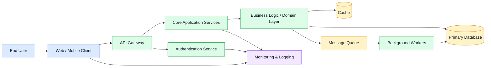

# Architecture Overview

## Components

- Client: Entry point for end users interacting with the platform.
- API Gateway: Handles inbound requests, routing, validation, and authentication.
- Authentication Service: Verifies user identity and issues tokens or sessions.
- Core Services: Implements business functionality and orchestrates domain operations.
- Domain Layer: Encapsulates business rules and application logic.
- Data Stores: Persistent storage and cache for application state and performance.
- Message Queue: Supports asynchronous processing and decoupled workflows.
- Background Workers: Process queued jobs and long-running tasks.
- Monitoring & Logging: Collects telemetry, traces, and operational metrics.

This diagram provides a high-level view of how the system components interact across the request path and background processing flow.
